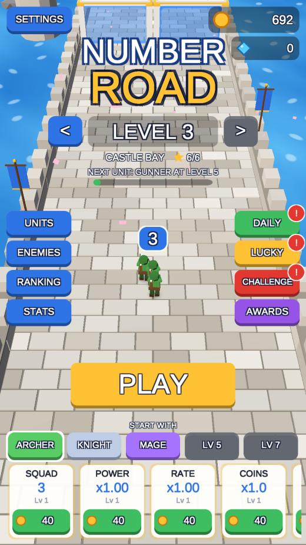
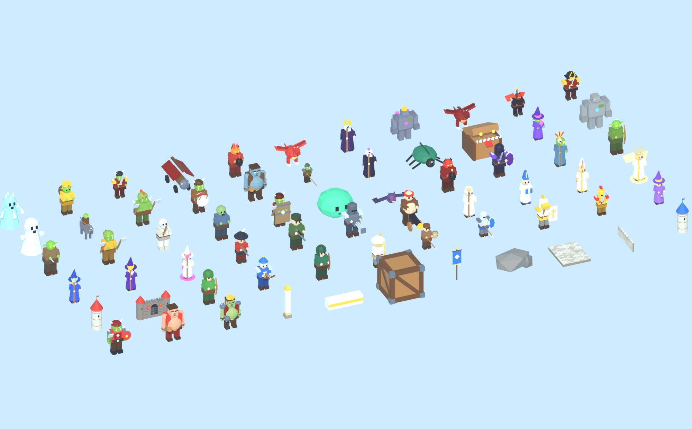

# Number Road（ナンバーロード）

「トップロード」の広告で見るような **数字ゲートを通って兵と弾を増やし、画面を埋めつくす敵の大軍とボスを撃退するディフェンスゲーム** を、Unity と Blender で作った個人用プロジェクトです。広告・課金・トラッキングは一切ありません。

- 指を左右にドラッグして兵団を動かす（PC は ←/→ キー・マウスドラッグ、Space で必殺技）
- `+10` `×2` などのゲートで兵が増え、`-5` `÷2` を通ると減る。1 列のゲートはレベルとともに 2 → 3 → 4 枚に、列の数も増えていく
- ＋・−・×・÷ と数値がくるくる変わる **ルーレットゲート**、中身が秘密の `?`、黄金の `×5`、撃って錠を壊す **カギ付きゲート**、左右に動く列
- 赤い数字の「撃つゲート」は弾を当てるたびに数字が増える。プラスにしてから通り抜ける
- `RATE+`（連射）`POWER+`（攻撃力）`MULTI+`（拡散弾）で武器、`+8 MAGE` で新しい兵種、`CLASS UP` で全員が 1 段階昇格
- 味方は 5 系統 × 4 段階の **20 兵種**（弓・盾・魔法・銃・聖職）。攻撃のしかたがそれぞれ違う
  - 弓：近い敵へ曲がって飛ぶ追尾矢（飛ぶ敵にも必中）／スナイパーは一番硬い敵を貫通射撃
  - 盾：前に来た敵をまとめて斬る近接なぎ払い（ノックバック・ガード付き）
  - 魔法：いちばん密集した所へ火球・氷爆弾・隕石を投げこむ範囲攻撃、ウィザードは 4 体へ連鎖する雷
  - 銃：まっすぐ速い弾、ガトリングは弾幕、キャノンは爆発
  - 聖職：空から光を落とす（盾をすり抜ける）＋倒れた兵の復活
- 属性（物理・炎・氷・雷・聖）があり、敵ごとに **弱点（1.75 倍）と耐性（0.45 倍）**。とどめを刺した弾は余ったダメージのまま次の敵へ進む
- 敵は **31 種類**（盾で正面の弾を止めるオーク、雷に弱い鎧の騎士、聖属性に弱いアンデッド、死ぬと地面を燃やすファイアインプ、炎で止まる再生トロール、狼の側面攻撃…）とボス 6 体。**レベル 1 から 200 体の大群** が 32 m 手前から一斉に押し寄せ、レベルとともに指数関数的に増える
- **ウェーブ制**：1 レベルは 3〜6 ウェーブ。ウェーブを越えるたびに道が止まり、**54 種のパワーアップ** から 3 枚を選ぶ（攻撃力・連射などの強化、炎・氷・雷・毒・爆発・跳弾などの弾のエンチャント、デメリット付きの大強化、回復、増員、倍率アップ。1 回だけ引き直し可）
- 撃破を続けると COMBO、たまると必殺技 **VOLLEY**（前方に矢の雨）
- **エンドレスモード**：ステージを次々に進む 1 本の長い戦い。兵・武器・パワーアップは次のステージへ引き継ぎ、**ボスを倒すたびに敵が 1% ずつ強くなる**。記録は倒したボスの数
- **FAST MARCH（加速前進）**：オンにすると、近くに敵がいない間は兵団が 1.8 倍の速さで進み、敵が近づくと自動で通常の速さに戻る
- **x2（倍速モード）**：プレイ中のゲーム全体を 2 倍速に。どちらのボタンも HUD 左上にあり、設定は次のプレイにも残る
- **CLAIM ALL**：たまった実績報酬・ログインボーナス・くじをまとめて受け取る（タイトル左上と実績画面）
- 最後は敵城の前でボス戦。コインと宝石で 8 種類の強化、毎日のログインボーナス・くじ・デイリーチャレンジ、実績 30 個、兵舎と敵図鑑
- **レベル選択**：タイトルの `<` `>` で一度到達したレベルを選び直せる（レベル番号をタップすると星つきの一覧）
- **ランキング**：この端末でのベスト記録 10 件を、スコア・最大兵数・最高コンボの 3 種類で表示（スコアは撃破数・コンボ・兵数とクリア・星から計算）
- **リセット**：設定画面の RESET PROGRESS から、確認のうえ最初からやり直せる（効果音・画質などの設定は残る）

「もう 1 回だけ」と遊びたくなるように入れた 100 個の工夫は [ADDICTION_IMPROVEMENTS.md](ADDICTION_IMPROVEMENTS.md) にまとめています。

| タイトル（スマホ縦） | プレイ中（iPad 縦） |
| --- | --- |
|  |  |

Blender で生成しているモデル一覧（味方 20 兵種・敵・ボス・背景）：



## 遊び方（スマホ・iPad）

**https://ksan260307.github.io/are1029/** を iPhone / iPad / Android の Safari・Chrome で開きます。共有メニューの「ホーム画面に追加」で、全画面のアプリのように起動できます。セーブ（レベル・コイン・宝石・強化・図鑑）はブラウザに残ります。

- 画面の向き：スマホは縦、iPad は縦横どちらでも遊べます（カメラが画面比に合わせて自動調整）
- ノッチやホームバーは Safe Area で避けています
- 重い端末では自動で軽い表示に切り替わります（設定の QUALITY で固定も可）
- アプリとして入れたい場合は、Unity のメニュー `Number Road > Build > Android APK / iOS Xcode Project` でローカルにビルドできます（Unity に Android / iOS のモジュールが必要）

## リポジトリ構成

```
.github/workflows/deploy-pages.yml  GitHub Pages への自動デプロイ（テスト・ビルド・公開）
blender/build_models.py             背景・ゲート・アイコンを生成し FBX / 立ち絵を出力（Blender 4.2+ / 5.x）
blender/characters.py               味方 20 兵種・敵・ボスのキャラクターモデル
blender/tests/                      Blender スクリプトの単体テスト
docs/                               ビルド済み WebGL（GitHub Pages の公開用）
media/                              README 用の画像
tools/                              ビルド・テストのスクリプトと、その単体テスト
NumberRoad/                         Unity プロジェクト（Unity 6000.5.4f1）
  Assets/NumberRoad/
    Scripts/Core/                   ゲームロジック（兵種・敵・ゲート計算・軍団・レベル生成・実績・デイリー・セーブ）
    Scripts/Gameplay/               進行・兵団・敵の大群（Swarm）・ボス・ゲート・弾・入力・オートパイロット
    Scripts/Presentation/           カメラ・背景・群衆描画・天気・パーティクル・効果音と BGM・振動（全部コード生成）
    Scripts/UI/                     タイトル / HUD / ポーズ / リザルト / 各種パネル / ワールドラベル
    Plugins/WebGL/                  ブラウザの振動（navigator.vibrate）
    Shaders/                        トゥーン・半透明・加算・水面（自前ライティング、キーワード不要）
    Resources/Models/               Blender から出力した FBX
    Resources/Portraits/            兵舎・図鑑・バナー用の立ち絵（Blender でレンダリング）
    Editor/                         プロジェクト設定の自動化・ビルドスクリプト
    Tests/                          EditMode（ロジック）/ PlayMode（実際に起動してオートプレイ）
  Assets/WebGLTemplates/NumberRoad/ スマホ向け全画面 WebGL テンプレート（ホーム画面追加対応）
```

アートは Blender のモデルと立ち絵以外すべてコードで生成しています（UI 部品、テクスチャ、効果音・BGM のシンセ）。

## 開発

### Unity で開く・ビルドする

- Unity Hub で `NumberRoad/` フォルダを開き、`Assets/NumberRoad/Scenes/Main.unity` を再生します（エディタでは `F1` でオートパイロット）。
  メニュー **Number Road > Setup Project** でマテリアル・シーン・プレイヤー設定を作り直せます。
- ローカルでビルドして `docs/` を更新：`powershell -ExecutionPolicy Bypass -File tools/build_webgl.ps1`
  （`-Assets` で Blender のモデル・アイコンの生成から、`-Setup` で Unity のセットアップからやり直す）
- ビルドした `docs/` をローカルで確かめるとき：`python -m http.server 8000 --directory docs` → http://localhost:8000
- 生成されるステージの中身を見る：メニュー `Number Road > Debug > Print Levels 1-10`

### アセットを作り直す

```powershell
& "C:\Program Files\Blender Foundation\Blender 5.2\blender.exe" -b --factory-startup --python blender/build_models.py '--' --preview media/models_preview.jpg --icons NumberRoad/Assets/NumberRoad/Art/Icons --portraits NumberRoad/Assets/NumberRoad/Resources/Portraits
```

- `--out` を省略すると `NumberRoad/Assets/NumberRoad/Resources/Models/` の FBX を上書きします（`--blend out.blend` で .blend も保存）
- 規約：モデルは -Y 向き（Blender の正面）、部位は `<モデル名>_LegL` のような名前（Body / LegL / LegR / ArmL / ArmR）、色は頂点カラー
- 味方は `u_`、敵は `e_`、ボスは `b_` で始まる名前。ゲーム側の表は `Scripts/Core/Units.cs` と `Scripts/Core/Enemies.cs`
- アイコンは次の Unity セットアップで WebGL テンプレートにも反映されます

### テスト

```powershell
powershell -ExecutionPolicy Bypass -File tools/run_tests.ps1            # すべて
powershell -ExecutionPolicy Bypass -File tools/run_tests.ps1 -Only PlayMode
```

| 種類 | 件数 | 場所 |
| --- | ---: | --- |
| Unity EditMode（単体） | 211 | `NumberRoad/Assets/NumberRoad/Tests/EditMode` |
| Unity PlayMode（総合） | 6 | `NumberRoad/Assets/NumberRoad/Tests/PlayMode` |
| Blender（単体） | 11 | `blender/tests` |
| Python（単体） | 22 | `tools/tests` |

PlayMode には、新しいセーブからオートパイロットで遊び（パワーアップも自動で選ぶ）、強化を買い、負けたらやり直しながら進めた記録をログに出す `BalanceSweep` と、エンドレスを 1 回通しで遊んでステージごとの兵数・パワーアップ・敵の強さを記録する `EndlessSweep` もあります（時間がかかるので明示したときだけ実行。`-testFilter` の名前を変えて使う）。

```powershell
& "C:\Program Files\Unity\Hub\Editor\6000.5.4f1\Editor\Unity.exe" -batchmode -nographics -projectPath NumberRoad -runTests -testPlatform PlayMode -testFilter NumberRoad.Tests.SmokeTests.BalanceSweep -logFile sweep.log
```

### 公開（CI/CD）

`main` に push すると `.github/workflows/deploy-pages.yml` が動き、GitHub Pages に公開されます。

1. リポジトリ設定 **Settings → Pages → Build and deployment → Source** を **GitHub Actions** にする（初回のみ）
2. そのままでも、リポジトリに入っているビルド済みの `docs/` が公開されます（公開前に `tools/check_build.py` で中身を検査）
3. GitHub Actions 上で Unity からビルドしたい場合は、**Settings → Secrets and variables → Actions** に次を登録します
   - `UNITY_LICENSE` … Unity Hub でライセンスを有効化したときにできる `Unity_lic.ulf` の中身（Windows: `C:\ProgramData\Unity\Unity_lic.ulf`）
   - `UNITY_EMAIL` / `UNITY_PASSWORD` … Unity アカウント（Pro ライセンスの場合は `UNITY_SERIAL` も）

   登録すると、push のたびに [game-ci](https://game.ci/) で Unity のテスト（EditMode / PlayMode）を実行し、WebGL をビルドして公開します。
4. ワークフローの権限は、ふだんは読むだけ（`contents: read`）。公開のジョブだけが `pages: write` / `id-token: write`、Unity のテストのジョブだけが `checks: write` を持ちます。

## 調整したいとき

- 難易度・数値：`Scripts/Core/Balance.cs`（行進速度、敵の数の増え方、雑魚の硬さ、コンボ、必殺技、ボス、強化コストなど）
- 兵種・敵：`Scripts/Core/Units.cs`（20 兵種の攻撃方法・属性・性能）、`Scripts/Core/Enemies.cs`（31 種の敵とボス 6 体の性能・特徴・弱点）、`Scripts/Core/Combat.cs`（弱点・耐性の倍率、余剰ダメージの引き継ぎ）
- パワーアップ：`Scripts/Core/Buffs.cs`（54 種の効果・出やすさ・重ねられる回数）
- エンドレス：`Scripts/Core/Endless.cs`（ボス 1 体ごとの敵の強化率）
- ステージ構成：`Scripts/Core/LevelGenerator.cs`（レベル番号から決定的に生成。敵の HP と数は「上手に選んだ場合」の兵力から自動計算）
- 見た目：`blender/characters.py`・`blender/build_models.py`（モデル）、`Scripts/Core/Biomes.cs`（地域ごとの空・霧・光・水・道の色と天気）
- フォント：`Assets/NumberRoad/Resources/Fonts/UIFont.ttf` を置くと UI 全体がそのフォントに切り替わります。UI の文言は英語にしてあります（WebGL は端末の日本語フォントを使えないため）。日本語表示にしたい場合は、日本語フォント（例：Noto Sans JP）をここに置いてから文言を書き換えてください

## 技術メモ

- Unity 6000.5.4f1 / Built-in Render Pipeline / 旧 Input Manager（タッチ・マウス・キーボード）
- ビルド設定は `Editor/ProjectSetup.cs` がコードで適用（WebGL: gzip＋解凍フォールバックで GitHub Pages 対応。Android: IL2CPP ARM64、iOS: iPhone+iPad）
- 敵は構造体の配列（`Gameplay/Swarm.cs`）で最大 3,000 体を同時に動かし、1 m 格子で近くの敵を探す。描画は部位ごとの GPU インスタンシング（`Presentation/CrowdRenderer.cs`）
- 大群を軽く動かす工夫
  - 大群は、兵団の 86 m 先に入った列から 1 体ずつの敵になる。それより奥はただの「数」として持つだけ
  - 待機中の敵と 34 m より遠い敵は数フレームおきにまとめて更新する。決めるのは兵団との距離だけで、フレームレートでゲームの中身は変わらない
  - 兵の狙い（近い 48 体・いちばん硬い敵・いちばん密集した場所）は 1 フレームに 1 回だけ求め、全員で共有する
  - 見た目だけの省略は描画側で行う：カメラから遠いキャラは脚を描かない（低画質ではより手前から）
  - 燃える地面は寿命つきの円。毎フレームの処理は距離の判定だけ。弾・閃光・地面の模様は固定長の配列を使い回し、毎フレームのメモリ確保をしない
- 兵は最大 999,999 人。描くのは 80 人までで、いる兵種は必ず 1 人以上描く。弾数は上限付きで、その分 1 発のダメージを上げて兵種ごとの DPS を正確に保っています（テストで保証）
- 弾・破片・影・天気も GPU インスタンシングで描画、物理エンジンは不使用
