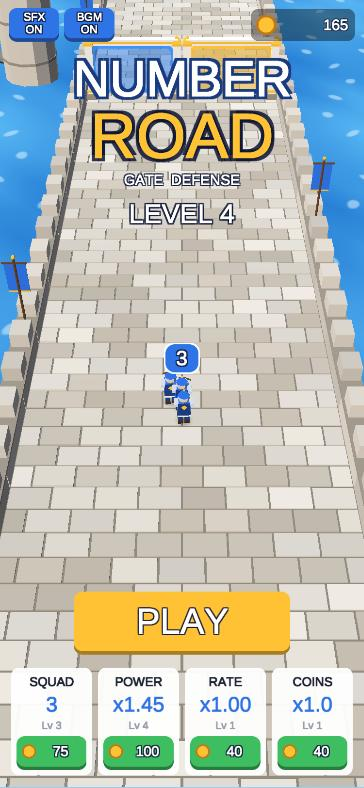
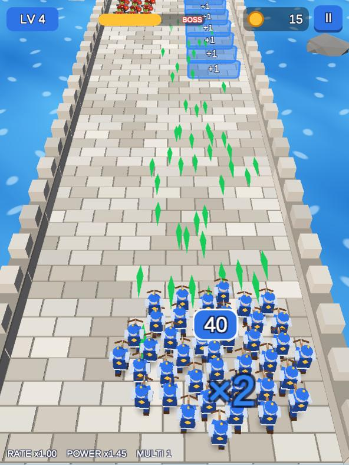
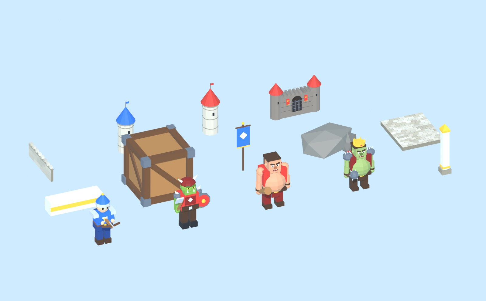

# Number Road（ナンバーロード）

「トップロード」の広告で見るような **数字ゲートを通って兵と弾を増やし、迫る敵軍とボスを撃退するディフェンスゲーム** を、Unity と Blender で作った個人用プロジェクトです。広告・課金・トラッキングは一切ありません。

- 指を左右にドラッグして兵団を動かす（PC は ←/→ キー・マウスドラッグ）
- `+10` `×2` などのゲートで兵が増え、`-5` `÷2` を通ると減る
- `RATE+`（連射）`POWER+`（攻撃力）`MULTI+`（拡散弾）で武器が強化
- 赤い数字の「撃つゲート」は弾を当てるたびに +1。プラスにしてから通り抜ける
- `+1` の列を通ると 1 人ずつ仲間が増える。反対側のレーンには敵部隊
- 木箱は撃ち壊すと報酬。壊さずぶつかると兵を失う
- 巨人（ブルート）は兵を叩き潰してくる。横に避けることもできる
- 最後は敵城の前でボス戦。倒せばクリア、コインで「初期兵数・攻撃力・連射・コイン獲得」を強化

| タイトル（スマホ縦） | プレイ中（iPad 縦） |
| --- | --- |
|  |  |

Blender で生成しているモデル一覧：



## 遊び方（スマホ・iPad）

| 端末 | 方法 |
| --- | --- |
| iPhone / iPad / Android（いちばん簡単） | GitHub Pages（このリポジトリなら https://ksan260307.github.io/are1029/ ）を Safari / Chrome で開き、共有メニューから「ホーム画面に追加」。全画面のアプリのように起動でき、セーブもブラウザに残ります |
| Android（ネイティブ） | Actions の成果物 or Releases の `NumberRoad-*.apk` をダウンロードしてインストール |
| iPhone / iPad（ネイティブ） | タグを打つと作られる `NumberRoad-*-unsigned.ipa` を [Sideloadly](https://sideloadly.io/) や AltStore で自分の Apple ID で署名してインストール。Mac があれば Xcode プロジェクト（成果物 `build-iOS` の tar.gz）を開いて実機に直接ビルドも可 |

画面の向き：スマホは縦固定、iPad は縦横どちらでも遊べます（カメラが画面比に合わせて自動調整）。ノッチやホームバーは Safe Area で回避しています。

## リポジトリ構成

```
.github/workflows/ci-cd.yml   GitHub Actions（テスト・ビルド・Pages 配信・リリース）
blender/build_models.py       全 3D モデルを Python で生成し FBX 出力（Blender 4.2+ / 5.x）
docs/images/                  README 用画像（モデル一覧など）
NumberRoad/                   Unity プロジェクト（Unity 6000.5.4f1）
  Assets/NumberRoad/
    Scripts/Core/             ゲームロジック（数値・ゲート計算・レベル生成・セーブ）※Unity 非依存寄りでテスト可能
    Scripts/Gameplay/         進行・兵団・敵・ゲート・弾・入力・オートパイロット
    Scripts/Presentation/     カメラ・背景・パーティクル・効果音（全部コード生成）
    Scripts/UI/               タイトル / HUD / ポーズ / リザルト / ワールドラベル
    Shaders/                  トゥーン・半透明・加算・水面（自前ライティング、キーワード不要）
    Resources/Models/         Blender から出力した FBX
    Editor/                   プロジェクト設定の自動化・ビルドスクリプト（CI から呼ばれる）
    Tests/                    EditMode（ロジック）/ PlayMode（実際に起動してオートプレイ）
  Assets/WebGLTemplates/NumberRoad/  スマホ向け全画面 WebGL テンプレート（ホーム画面追加対応）
```

アートは Blender のモデル以外すべてコードで生成しています（UI 部品、テクスチャ、効果音・BGM のシンセ）。音声ファイルや画像素材の差し替え不要で、そのままビルドできます。

## ローカルで動かす

1. Unity Hub で **Unity 6000.5.4f1** をインストール（Android / iOS / Web Build Support は必要なものだけ）
2. Unity Hub の「追加」で `NumberRoad` フォルダを開く
3. 初回はシーン・マテリアル・設定が自動生成されます（メニュー `Number Road > Setup Project` で再実行可）
4. `Assets/NumberRoad/Scenes/Main.unity` を開いて ▶ Play
   - エディタでは `F1` でオートパイロット（自動操作）を切り替え
5. ビルドはメニュー `Number Road > Build > WebGL / Android APK / iOS Xcode Project`
   - WebGL は `index.html` を直接開いても動かないので、出力フォルダで `python -m http.server 8000` などを起動して http://localhost:8000 を開きます

### Blender でモデルを作り直す

```bash
blender -b --factory-startup -P blender/build_models.py -- --preview docs/images/models_preview.jpg --icons NumberRoad/Assets/NumberRoad/Art/Icons
```

- `--out` を省略すると `NumberRoad/Assets/NumberRoad/Resources/Models/` に FBX を上書きします
- `--blend out.blend` で .blend も保存できるので、GUI で手直しして FBX を書き出しても OK
- 規約：モデルは -Y 向き（Blender の正面）、部位は `<モデル名>_LegL` のような名前、色は頂点カラー。Unity 側は FBX が無くても仮モデルで動きます

### テスト

Unity の Test Runner（Window > General > Test Runner）か、コマンドラインで：

```bash
Unity -batchmode -nographics -projectPath NumberRoad -runTests -testPlatform EditMode -testResults editmode.xml
```

## CI/CD（GitHub Actions）

`.github/workflows/ci-cd.yml` が次を行います。

| きっかけ | 実行内容 |
| --- | --- |
| push / Pull Request | Blender スクリプトの実行チェック、Unity テスト（EditMode + PlayMode）、WebGL と Android のビルド |
| `main` への push | 上記 + **WebGL を GitHub Pages に自動デプロイ**（スマホのブラウザですぐ遊べる） |
| `v1.0.0` のようなタグ | 上記 + iOS（Xcode プロジェクト → 未署名 .ipa）+ **GitHub Release に APK / IPA / WebGL zip を添付** |
| 手動実行（Run workflow） | iOS も作るか選べます |

Unity のビルドには [GameCI](https://game.ci/) を使っています。ライセンス用のシークレットが未設定の間は Unity のジョブを自動でスキップし、警告を出すだけにしています。

### 1. Unity ライセンスをシークレットに登録（必須）

1. Unity Hub →「環境設定」→「ライセンス」→「追加」→「無料の Personal ライセンスを取得」
2. 作成された `C:\ProgramData\Unity\Unity_lic.ulf`（Mac は `/Library/Application Support/Unity/Unity_lic.ulf`）をメモ帳で開く
   ※ Hub にライセンスが表示されていても .ulf が無いことがあります。その場合は上の手順で追加し直してください
3. GitHub のリポジトリ → Settings → Secrets and variables → Actions → New repository secret で 3 つ登録

| 名前 | 値 |
| --- | --- |
| `UNITY_LICENSE` | `.ulf` ファイルの中身すべて |
| `UNITY_EMAIL` | Unity アカウントのメールアドレス |
| `UNITY_PASSWORD` | Unity アカウントのパスワード |

### 2. GitHub Pages を有効化（WebGL 配信）

Settings → Pages → Build and deployment の Source を **GitHub Actions** にします。以後 `main` に push するたびに `https://<ユーザー名>.github.io/are1029/` が更新されます。

### 3. Android の署名鍵（任意・おすすめ）

未設定でも APK は作られますが、毎回違うデバッグ鍵で署名されるため、更新時にアンインストールが必要になります（セーブも消えます）。固定の鍵を作って登録すると上書きインストールできます。`keytool` は Java（JDK）に付属しています（Unity の Android Build Support を入れると `Editor/Data/PlaybackEngines/AndroidPlayer/OpenJDK/bin` にもあります）。

```bash
keytool -genkeypair -v -keystore numberroad.keystore -alias numberroad -keyalg RSA -keysize 2048 -validity 10000
```

```bash
base64 -w 0 numberroad.keystore
```

| 名前 | 値 |
| --- | --- |
| `ANDROID_KEYSTORE_BASE64` | 上の base64 出力 |
| `ANDROID_KEYSTORE_PASS` | keystore のパスワード |
| `ANDROID_KEYALIAS_NAME` | `numberroad` |
| `ANDROID_KEYALIAS_PASS` | 鍵のパスワード |

keystore ファイル自体は `.gitignore` 済みです。なくさないよう安全な場所に保管してください。

### 4. リリースを作る

```bash
git tag v1.0.0
```

```bash
git push origin v1.0.0
```

Releases に APK・未署名 IPA・WebGL の zip が並びます。

## 調整したいとき

- 難易度・数値：`Scripts/Core/Balance.cs`（行進速度、連射、ボス、強化コストなど）
- ステージ構成：`Scripts/Core/LevelGenerator.cs`（レベル番号から決定的に生成。敵の HP は「普通に上手く選んだ場合」の兵力から自動計算）
- 見た目：`blender/build_models.py`（モデル）、`Scripts/Presentation/WorldView.cs`（空・霧・光の色）
- フォント：`Assets/NumberRoad/Resources/Fonts/UIFont.ttf` を置くと UI 全体がそのフォントに切り替わります。UI の文言は英語にしてあります（WebGL は端末の日本語フォントを使えないため）。日本語表示にしたい場合は、日本語フォント（例：Noto Sans JP）をここに置いてから文言を書き換えてください

## 技術メモ

- Unity 6000.5.4f1 / Built-in Render Pipeline / 旧 Input Manager（タッチ・マウス・キーボード）
- ビルド設定は `Editor/ProjectSetup.cs` がコードで適用（Android: IL2CPP ARM64、iOS: iPhone+iPad、WebGL: gzip＋解凍フォールバックで GitHub Pages 対応）
- 兵は最大 40 体を描画し、それ以上は数字で表示。弾数は上限付きで、その分 1 発のダメージを上げて総 DPS を正確に保っています（テストで保証）
- 弾・破片・影は GPU インスタンシングで描画、物理エンジンは不使用
